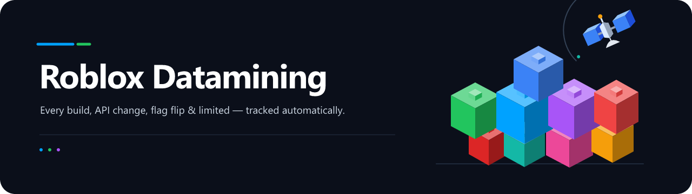
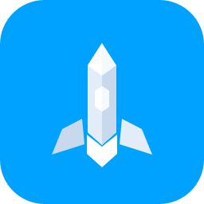
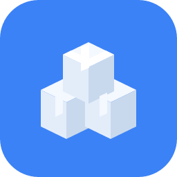
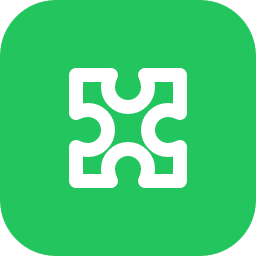
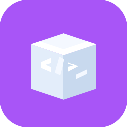
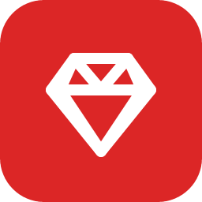
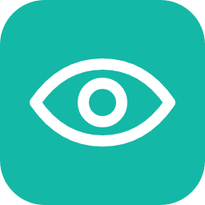

<div align="center">



<p>


</p>

<em>No build step · snapshots commit to git · diffs post to Discord · proxy-ready</em>

</div>

# 🛰️ Roblox Datamining

<!-- status:start -->
<p align="center"><a href="https://github.com/Just3itx/Roblox-Datamining/actions/workflows/mine.yml"></a> <a href="https://github.com/Just3itx/Roblox-Datamining/actions/workflows/ci.yml"></a> <a href="https://github.com/Just3itx/Roblox-Datamining/commits/main"></a></p>

### 🚀 Live builds

| Binary | Version |
| --- | --- |
| 🪟 Windows Player | `0.748.0 · build 7481526` |
| 🪟 Windows Studio | `0.748.0 · build 7481526` |
| 🍎 Mac Player | `0.748.0 · build 7481526` |
| 🍎 Mac Studio | `0.748.0 · build 7481526` |

### 📊 Tracked right now

|  | Snapshot | Data |
| --- | --- | --- |
| 🧩 API dump | 960 classes · 8,927 members · 664 enums | [`data/api-dump`](data/api-dump) |
| 🚩 Fast flags | 209,334 values across 9 apps | [`data/fflags`](data/fflags) |
| 🎮 Top playing now | [Steal An Egg](https://www.roblox.com/games/107778070777162) · [Brookhaven 🏡RP](https://www.roblox.com/games/4924922222) · [Blox Fruits](https://www.roblox.com/games/2753915549) | [`data/games`](data/games) |
| 🛍️ Latest Roblox items | [Key of Infinite Wonders](https://www.roblox.com/catalog/122679841619004) · [Shedletsekkar](https://www.roblox.com/catalog/93762663362787) · [Courtside Golden Hour](https://www.roblox.com/catalog/81421947324360) | [`data/catalog`](data/catalog) |

<sub>Last change detected 2026-11-26 00:00 UTC. This block is rewritten by the miner.</sub>
<!-- status:end -->

---

## ✨ What gets tracked

<table>
<tr>
<td width="33%" align="center"><br><b>Client versions</b><br><sub>Player & Studio builds<br>Windows + Mac</sub></td>
<td width="33%" align="center"><br><b>Deploy history</b><br><sub>LIVE, zcanary, znext<br>channels</sub></td>
<td width="33%" align="center"><br><b>API dump</b><br><sub>classes, members, enums<br>diffed per build</sub></td>
</tr>
<tr>
<td align="center"><br><b>CoreScripts (Luau)</b><br><sub>client script files<br>that changed</sub></td>
<td align="center"><br><b>Fast flags</b><br><sub>FFlag / FInt / FString<br>across 9 apps</sub></td>
<td align="center"><br><b>Experience charts</b><br><sub>Discover sorts:<br>who entered & left</sub></td>
</tr>
<tr>
<td align="center"><br><b>Catalog</b><br><sub>new items, price/stock,<br>🔜 coming-soon</sub></td>
<td align="center"><br><b>Limited items</b><br><sub>~1,000 limiteds:<br>resale, stock, sell-outs</sub></td>
<td align="center"><br><b>Watchlist</b><br><sub>your ids — alert on<br>release & change</sub></td>
</tr>
<tr>
<td align="center">🌐<br><b>Website CSS/JS</b><br><sub>rbxcdn + create.roblox<br>bundles per deploy</sub></td>
<td align="center">🤖<br><b>Android APK</b><br><sub>configs, translations,<br>.rbxm models, manifest</sub></td>
<td align="center">📜<br><b>+ Luau later</b><br><sub>decompiler route<br>(see notes)</sub></td>
</tr>
</table>

<details>
<summary><b>📋 Sources & cadence</b></summary>

<br>

| | Tracker | Source | Cadence |
| --- | --- | --- | --- |
| 🚀 | **Client versions** | `clientsettings.roblox.com` | ~10 min |
| 📦 | **Deploy history** | `setup.rbxcdn.com` | ~10 min |
| 🧩 | **API dump** | `setup.rbxcdn.com` | ~10 min (downloads only on new builds) |
| 📜 | **CoreScripts (Luau)** | `MaximumADHD/Roblox-Client-Tracker` | ~10 min |
| 🚩 | **Fast flags** | `clientsettingscdn.roblox.com` | ~10 min |
| 🌐 | **Website CSS/JS** | `css`/`js.rbxcdn.com` · `create.roblox.com` | every 3 h |
| 🤖 | **Android APK** | APKPure (`com.roblox.client`) | **local only** — APKPure 403s datacenter IPs, so run `npm run mine:android` from a home IP / the local task, not GitHub Actions |
| 🎮 | **Experience charts** | `apis.roblox.com/explore-api` | every 3 h |
| 🛍️ | **Roblox catalog** | `catalog` + `economy.roblox.com` | every 3 h |
| 🔴 | **Limited items** | `catalog.roblox.com` | every 3 h |
| 👁️ | **Watchlist** | `economy.roblox.com` | every 3 h |

</details>

### 📦 Every change produces…

- a **commit** with a summary subject — `🚀 0.749.0 · 🧩 API +41 −2 ~5 · 🚩 FFlags +12 −3 ~5`
- a **commit comment** with the full report: tables, collapsible `diff` blocks and links
- updated snapshots under [`data/`](data), so `git log -p` and GitHub's history view are a changelog
- an archived API changelog per build in [`data/api-dump/changes/`](data/api-dump/changes)
- a colour-coded **Discord** post per tracker, to its own channel (see **🔔 Discord alerts** below)

<details>
<summary><b>👀 Example — an API-dump change</b></summary>

```diff
  Class Instance [NotCreatable, NotBrowsable]
+     Event Instance.Destroying()
-     Property Instance.Name: string
+     Property Instance.Name: string [NotReplicated]
+ Class Sparkle : Instance
+     Property Sparkle.Color: Color3
```

</details>

## 🧭 How it works

```
   ⏰ GitHub Actions (cron, off-peak)
          │
          ▼
   node src/cli.ts <trackers>
          │
   ┌──────┴───────────────────────────────┐
   │  fetch   → Roblox endpoints (proxied) │
   │  diff    → previous snapshot in data/ │
   │  write   → data/**  +  README status  │
   │  render  → out/report.md · message    │
   └──────┬───────────────────────────────┘
          │
   ┌──────┴──────┐
   ▼             ▼
 📦 git commit   🔔 Discord
    + push          containers
```

Every tracker implements the same small contract ([`src/trackers/types.ts`](src/trackers/types.ts)): **fetch → compare with the stored snapshot → write the new one → return a `Section`** describing what changed (or `null`). One renderer turns sections into the markdown report, the Discord containers, and the commit message.

## 🛠️ Running locally

Requires **Node.js 24+**. No build step — Node runs the TypeScript directly.

```bash
npm install
npm run mine                 # every tracker
npm run mine -- fflags       # just one
npm run mine:fast            # versions, deploy-history, api-dump, luau, fflags
npm run mine:slow            # games, catalog, limiteds, watchlist
npm run check                # typecheck + tests
```

Snapshots go to `data/`, and the report + commit message + `result.json` to `out/`. Point them elsewhere with `--data-dir` / `--out`.

## 🔔 Discord alerts

Each change posts to its own channel as a **Components V2 container** — accent-coloured per tracker, with **ANSI-coloured diffs** (🟢 added · 🔴 removed · 🟡 changed), a custom emoji + icon avatar, and readable versions like `0.748.0 · build 7481526`. Webhook URLs are **secrets**, so they never live in the repo.

First, in Discord make a category with one channel per tracker and a webhook in each (**Channel → Edit → Integrations → Webhooks**), then fill a config from [`discord.config.example.json`](discord.config.example.json). A tracker with no URL (and no `default`) is simply skipped. The avatar/emoji art lives in [`assets/icons`](assets/icons) and [`assets/emoji`](assets/emoji) (`npm run icons` to rebuild).

**On GitHub Actions (default):** store the whole config as a repo secret named `DISCORD_CONFIG`, and the [Mine workflow](.github/workflows/mine.yml) writes it out and runs with `--discord` automatically:

```bash
gh secret set DISCORD_CONFIG < discord.config.json
```

**Locally:** save the config as `discord.config.json` (git-ignored) and run `node src/cli.ts --discord`. [`scripts/run-local.ps1`](scripts/run-local.ps1) + [`scripts/install-task.ps1`](scripts/install-task.ps1) can schedule it via Windows Task Scheduler if you ever want to mine from your own PC instead.

> Run the miner from **one** place to avoid double posts — the Actions cron **or** local tasks, not both.

## 👁️ Watching specific items

To catch a specific upcoming item or bundle the moment it goes live, add its id to [`watchlist.json`](watchlist.json):

```json
{ "items": [ { "id": 123456789, "type": "Asset", "note": "leaked UGC limited" } ] }
```

The watchlist tracker checks each one every slow run and reports when it **appears**, **goes on sale**, or changes. (True "hidden" scanning isn't possible from public APIs — asset ids are globally sparse, so there's no range to sweep — but the watchlist plus the catalog 🔜 flag catch items as soon as they're created.)

## 🤖 Working with GitHub Copilot

This repo is set up for the [Copilot coding agent](https://docs.github.com/en/copilot/concepts/agents/coding-agent):

- [`.github/copilot-instructions.md`](.github/copilot-instructions.md) explains the architecture and the rules
- [`.github/workflows/copilot-setup-steps.yml`](.github/workflows/copilot-setup-steps.yml) gives the agent Node 24 and the dependencies
- the **New tracker** issue template is written so you can assign the issue straight to `Copilot`
- [CI](.github/workflows/ci.yml) typechecks and tests every pull request it opens

## 📁 Layout

```
src/
  cli.ts          entry point: runs trackers, writes out/, posts to Discord
  readme.ts       rewrites the live status block above
  core/           http (proxy/retry) · store · diff · report · discord
  trackers/       one file (or folder) per data source
scripts/          generate-icons.mjs · run-local.ps1 · install-task.ps1
assets/           icons/ (avatars) · emoji/ (transparent)
data/             mined snapshots — generated, never hand-edited
.github/          workflows · Copilot instructions · issue templates
```

## 🛰️ Proxies (optional)

The `catalog.roblox.com` host is limited to ~12 requests/min, and GitHub Actions IPs can get throttled. Set the `ROBLOX_PROXY` env var (or a repo **variable** of that name for Actions) to route the rate-limited hosts through community proxies, with automatic fallback to `roblox.com`:

```bash
ROBLOX_PROXY="roproxy.com,rotunnel.com" npm run mine
```

Each proxy is tried in order, then the direct host. Only `catalog`, `economy`, `apis` and `games` are proxied (`clientsettings` is already fast and `clientsettingscdn` isn't mirrored). No auth or cookies ever pass through a proxy — only public reads.

## ⚖️ Notes

This project only reads **public, unauthenticated** endpoints, at a low rate, and never sends cookies or credentials (including through a proxy). It is **not affiliated with or endorsed by Roblox Corporation**; "Roblox" is a trademark of Roblox Corporation.

<div align="center">
<br>
<sub>🛰️ Built with TypeScript · mined on GitHub Actions · icons by <a href="https://github.com/openai/codex">Codex</a></sub>
</div>
